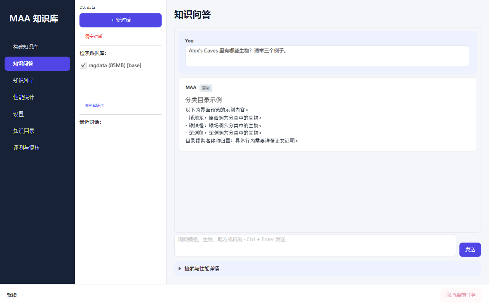
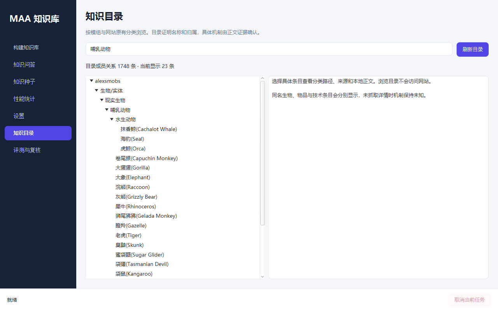

# 检索性能与工作流优化（2026-10-11）

## 实现边界与不变量

- 原有 `rag_web_cache.sub_web_page_json` 保持兼容；分类索引并行提供对象类型与完整路径。
- 公共网页缓存不包含聊天内容，不改变会话向量库的归属；每个会话仍可以单独删除、切换与检索。
- 公共缓存不属于 `DatabaseBuilder.BUILD_TABLES`，不参与基础库构建代次和内容指纹。重建基础库使用 staging 事务发布。
- 模组机制从百科正文获取；实际配方、注册名、纹理以安装 JAR 为先。不能把用户评论或整页导航当成机制证据。

## 公共网页与向量复用

`PublicKnowledgeCache` 保存 `rag_public_page`（解析后的正文、注册名、抓取时间、提取规则版本、ETag / Last-Modified）与 `rag_public_embedding`（内容块身份、模型指纹、向量）。

有效快照默认保留 7 天，页面最多 512 个。过期时，如果网站提供验证器，就发送条件请求；304 复用原正文并更新有效时间。304 仍计为一次 HTTP 请求。网络失败不静默续期旧正文。网站没有验证器时重新下载，并通过内容块哈希复用未变化的向量。

提取规则版本变化会使旧解析快照失效。模型指纹参与向量缓存联合键；模型不同不得复用向量。内容与来源共同决定块身份。公共缓存命中后向量复制进当前会话库，网页排序从已存向量读取，取消全文第二次推理。

Build 阶段的基础 Wiki 也使用同一公共快照和向量缓存。默认每个模组预热不超过 6 个不同生物子分类的代表页面，并补充已校验关系涉及的少量页面。`-Dmaa.build.prewarmPages=0` 关闭预热；默认不会抓取所有详情页。目录全量保留，预热不代表完整机制覆盖。

## 结构化正文与类型路由

网页分块保留标题与章节，仍限制在 180 个 UTF-16 单元内。表格列标题保持当前上下文，行标题随数据行输出，不再累计历史行标题；避免行数增长导致文本二次方膨胀。

查询生物时先使用生物/实体分类的中文名与英文名，再回退兼容别名库，避免同名物品抢占生物页面。选定页面保留引言及问题相关操作段落。相同来源与块身份的证据在回答上下文中只发送一次。

目录枚举保留规划器解析出的主体约束，例如“龙有哪些”先限制到名称或分类路径包含该主体的成员。没有明确数量要求时，基础目录枚举最多列出 30 个成员；举三个例子等明确数量按请求处理。普通生物举例排除目录明确标注的技术实体与交通工具，直接询问实体或载具时仍保留这些分类。行为筛选仍需要详情证明。

Wiki 信息框中的生命值等属性属于有效事实，正文提取必须保留；历史、音效和进度在排序时降低优先级。伤害与秒杀问题优先检索生命值、免疫和受伤条件。提取版本为 4，旧版公共快照不会直接复用。

每页仍最多提供 10 个正文块。排序优先匹配制作、酿造、获取、掉落、孵化等诉求对应的章节，并限制长章节的初始占额；覆盖其他章节后再填充余量。章节多样性不扩大上下文预算，也不增加网页或模型请求。

`knowledge-hints.json` 是可维护的领域关系数据，不保存预制答案或测试题编号。关系限定模组、真实目录条目、来源 URL 与关系类型。原型关系仍使用条件措辞，不能升级为正式同义名称；机制歧义关系只把问题分支导向已确认的正文页面。

目前收录：

- 霸王龙 / T-Rex → 撼地龙，关系为原型，来源：[撼地龙正文](https://www.mcmod.cn/item/750369.html)。
- 法术等级 → 卷轴等级与法术强度两个解释，来源：[奥术铁砧](https://www.mcmod.cn/item/699084.html)、[法术强度](https://www.mcmod.cn/item/764056.html)。

未收录关系仍走目录检索；不能凭模糊相似性直接断言对象不存在或把候选当成同义对象。

模组范围内没有字面命中时，先核验其他已安装模组的真实同名条目，再考虑原型或相近候选。跨模组证据明确标注归属纠偏，不能作为用户点名模组的机制事实。

## 规划与模型交互

`EntityAgent.analyze` 同时产生问题意图、对象类型、范围、枚举条件和原版支撑主题。有效规划不再额外调用 ClassifyAgent；无法产生有效意图时保留原分类器兜底。原版生物机制与模组法术交互可分别检索，原版支撑页不会被全局模组过滤丢弃。

基础名称枚举直接从分类目录挑选不同子分类的例子，不额外调用模型选择。带行为条件的枚举利用已有公共正文线索选择候选，再读取详情证明行为；当前仍采用有上限的候选预算，不能保证穷举完整性。

回答模型不再保留历史检索大包。最近用户问题和简短回答用于指代解析，当前事实由当前检索证据提供。支持的配方用结构化摘要；未支持摘要的配方类型保留原始 JSON，避免丢失特殊机器配方信息。

制作与获取问题额外支持工作站的一跳检索：自定义配方命名空间必须与来源模组一致，机器类型必须匹配同模组实际目录中的英文工作站名称。已抓页面不再重复添加，最多补充两个工作站正文。配方提供具体输入输出，工作站正文补充初始原料来源及操作机制；不递归抓取整条依赖图。

冰火传说 `iceandfire` 的机制来源固定继承原模组目录 [class/770](https://www.mcmod.cn/class/770.html)，保留安装的社区版身份。分支新增与改动仅在存在具体证据时说明；不会因为移植版本缺少独立知识页就要求重新建立一套百科。

## 观测与评测

每轮记录实际 HTTP 尝试（包含重试及跳转）、响应正文 bytes、内存与持久缓存命中、正文推理、查询推理、向量复用读取次数与推理耗时。正文 bytes 是响应读取量，不是压缩后的网络线缆流量；向量复用是读取计数，可能重复读取同一块。旧运行未观测的值属于未知，不可当作零。

`EvalRunner` 自动生成 `human-review.md`，包含规则未通过、裁判 partial/fail/error 的完整回答与实际证据。人工决定单独记录，不覆写原始裁判结果，也不将待判项自动视为正确。

黄金集 v7 纳入人工已确认标准：法术等级允许澄清且优先分别回答；霸王龙需要有条件介绍真实候选；水滴鱼不强制回答全部生物特征，材料用途正确可通过。正文确实记录深海及水层变化，评论中的失压死亡故事不作为事实或评分要求。

## JavaFX 界面

界面采用集中 CSS、明确的导航激活状态和中文主要操作。知识问答支持多行输入及 Ctrl + Enter，来源、覆盖范围与性能详情折叠展示。新增本地知识分类树和评测报告浏览页；选择目录条目不访问网站。API Key 使用密码输入框显示。

后台仍串行执行共享 Agent 操作，取消按钮向当前工作线程发出中断，不提前解除忙碌状态。构建在发布前检查取消；事务发布后不能把一次已提交的构建当作撤销。网络调用可能需等待当前请求退出。性能进度是阶段内进度，不是整体 ETA。

界面快照已验证控件布局与长目录展示；问答快照采用明确标注的示例内容，不代表在线测试回答。

## 验证记录

自动化测试：77 项，0 失败、0 错误、0 跳过；使用离线 Maven 依赖仓库执行 `package -Prelease`，模型资源完整性检查已运行。release ZIP 已验证包含界面 CSS、领域关系数据、工作站检索类及 ONNX 模型。

先导完整运行 `run-20261011-134403-40ddc09e-optimization-final` 保存于 `target/e2e-optimization-20261011-v1/eval-runs/`：规则 46/50、裁判 41 PASS。平均问答 5,888 ms、P95 10,051 ms、平均模型调用 2.80 次。暴露的主体枚举范围丢失、技术实体误充生物、Markdown 打断拒答断言、Wiki 信息框丢失等已修正；该报告保留原始结果，不作为最终通过结论。

最终从零构建 `target/e2e-optimization-20261011-v2` 完成于本轮：7 个模组、4,377 条配方、14,298 个基础向量，用时 215.174 秒。完整在线运行及跨进程复测已结束，记录见下方验证文档。

## 后续改进边界

- 攻略问题需要攻略级来源及步骤覆盖，单一实体机制页不必然包含可执行打法；应优先扩展来源路由，不靠回答模型补写缺少证据的步骤。
- 同名材料的完整获取链可能需要材料 → 来源生物的关联；目前已实现工作站一跳，尚未建立通用掉落／来源图。
- 全量行为枚举仍需分批属性核验与可恢复覆盖记录；有限页面预算只支持有明确覆盖说明的部分名单。
- 公共页面有数量上限，但脱离页面记录的基础来源向量、旧内容及旧模型指纹的缓存向量仍可能累积，可后续增加低优先级清理策略。
- 构建分类时仍会尝试部分不存在的分类，并等待一次重试；可依据主目录声明减少无效探测，需保留自定义分类兼容性。
- 规则关键字断言不能可靠区分所有否定、条件性说明和正确步骤，裁判也存在完整性标准漂移；人工政策应单独记录并转成具有明确边界的断言。

最终冻结代码、完整集与跨进程复测记录见 [验证与性能记录](reviews/20261011-validation.md)；8 项待判问题见 [人工复核](reviews/20261011-human-review.md)。

## 人工复核后的修订

后续八项人工结论、工作流与链接修订、最终回归结果见 [复核实施记录](reviews/20261011-adjudication-implementation.md)。本文件的前轮测试数据保留为历史记录。
